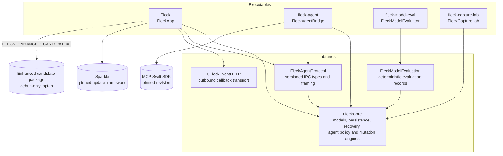
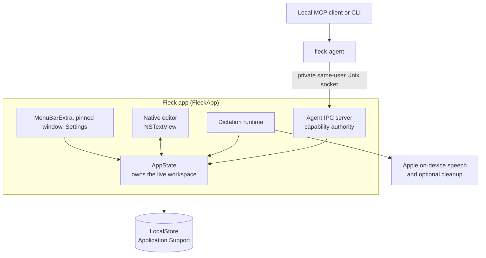
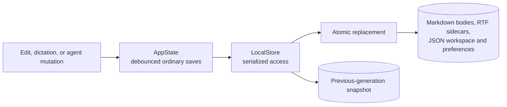
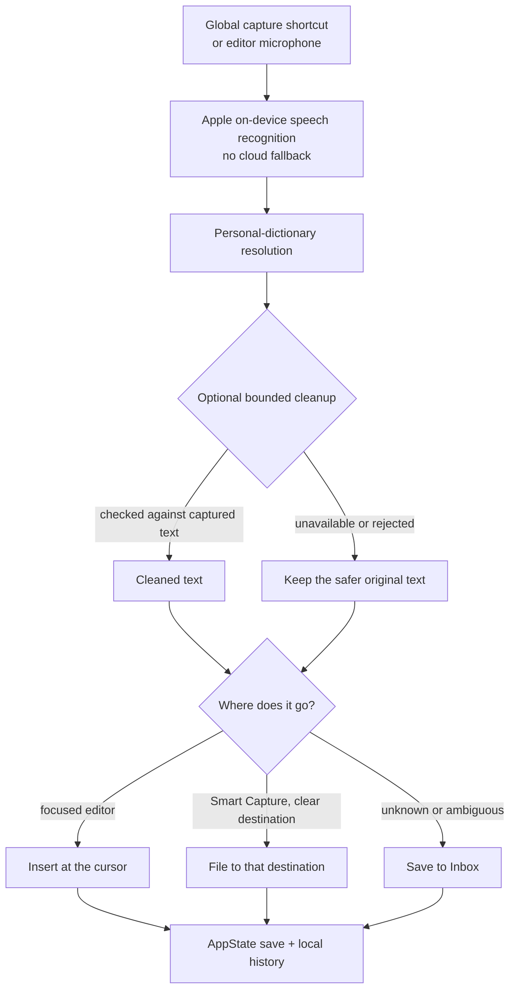
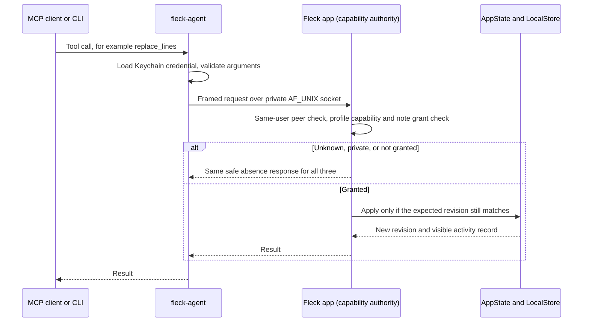

<h1 align="center">
  <picture>
    <source media="(prefers-color-scheme: dark)" srcset="Assets/Brand/fleck-lockup-white.png">
    
  </picture>
</h1>

<p align="center">Local-first notes for the macOS menu bar.</p>

<p align="center">
  <a href="#requirements"></a>
  <a href="Package.swift"></a>
  <a href="https://github.com/elevatesoft/Fleck/actions/workflows/ci.yml?query=branch%3Amain"></a>
  <a href="LICENSE"></a>
  <a href="docs/RELEASES.md"></a>
</p>

<p align="center">
  <a href="#download-and-launch-fleck">Download</a> ·
  <a href="#documentation">Documentation</a> ·
  <a href="#requirements">Developing</a> ·
  <a href="#how-it-works">How it works</a> ·
  <a href="#architecture">Architecture</a> ·
  <a href="#contributing">Contributing</a>
</p>

Fleck is a place to catch a thought without leaving what you're doing. Open it
from the menu bar and type or dictate a note. Come back to format it in the
native editor, file it in a folder, or link it to another note. Fleck keeps
readable Markdown and rich-text formatting on your Mac, without a Fleck
account or cloud sync.

You can give an AI tool access to just the notes you choose. The optional
[Agent Connector](#agent-connector) lets you grant a compatible client read or
edit access, see what it changed, and undo eligible edits.


*The Project notes tab is open in the native editor. The toolbar puts dictation
and formatting above the note, and the Reference.txt shortcut keeps a related
file within reach without importing it. This development screenshot uses sample
notes; the downloadable preview may look different.*

## Download and launch Fleck

The published app is [Fleck 1.1.2-beta.2 (Build 84)](https://github.com/elevatesoft/Fleck/releases/tag/v1.1.2-beta.2),
an early **Developer Preview** for **Apple silicon**. macOS 14 is the declared
minimum, but a full macOS 14 native pass and Intel compatibility haven't been
verified. The preview isn't notarized, and behavior and storage formats may
change.

### Installing the app release

1. In the release's **Assets**, download `Fleck.1.1.2-beta.2.Build.84.app.zip`,
   not a **Source code** archive. In Terminal, from the folder containing the
   ZIP, run `shasum -a 256 Fleck.1.1.2-beta.2.Build.84.app.zip` and compare
   the result with the SHA-256 shown on the release page.
2. Extract the ZIP and drag `Fleck 1.1.2-beta.2 Build 84.app` into **Applications**.
   Try opening it there. If macOS warns about the lack of notarization, see
   [Apple's guidance](https://support.apple.com/en-us/102445) before deciding
   whether to open it. Don't disable Gatekeeper.
3. Click Fleck's four-tile icon in the **menu bar** (there's no Dock icon).
   Create a note, give it a title, and start typing. It saves automatically.
   To try Apple's on-device dictation, click the toolbar microphone and grant
   microphone permission when prompted.

The prebuilt app doesn't need Xcode. The preview includes native formatting,
tabs and folders, workspace search, `[[note links]]` with backlinks, inline
images from Finder, and optional Agent Connector setup. It doesn't package
in-app onboarding; the [release notes and first-launch guide](docs/release-notes/1.1.2-beta.2.md)
cover the editor, keyboard shortcuts, dictation, and agent setup.

Public `main` has changes that aren't in Build 84, such as inline image resizing
and rotation, copying mixed text and images as rich content, and line diffs in
Agent Activity. The sections below describe **current public source**, not
the contents of that download. [`VERSION`](VERSION) identifies the source
version, the [changelog](CHANGELOG.md) records source changes, and
[GitHub Releases](https://github.com/elevatesoft/Fleck/releases) lists available
app packages. Local development builds and CI artifacts aren't public releases.
The [1.8.0-beta.1 development notes](docs/release-notes/1.8.0-beta.1.md) record
earlier source-preview changes, including native selection drags and editor
fixes; they don't describe a downloadable app.

## What is here

The ordinary build from public `main` contains:

| Area | Current implementation |
| --- | --- |
| Native workspace | Menu-bar workspace and an independently sized pinned window. |
| Notes and organization | Local notes, tabs, folders, search, backlinks, 30-day Trash, recovery, text/Markdown import, and plain-text/Markdown/RTF export. |
| File shortcuts | A native single-file chooser adds local file references; compact rows can open, reveal, relink, or remove them. Shortcuts stay on this Mac and are not included in note exports. |
| Native editor | An AppKit `NSTextView` editor with native undo, formatting, lists, checklists, and inline display of image files pasted or dropped from Finder. |
| On-device dictation | Apple on-device speech recognition, optional faithful local cleanup, and Inbox-safe Smart Capture routing. |
| Agent Connector | A separately packaged local helper with profile-scoped capabilities, explicit note or folder grants, visible activity, revision checks, and Undo. |
| Local persistence | Readable local storage with atomic replacement and a previous-generation recovery snapshot. |

Inline image import accepts image **file URLs**, such as files copied or dragged
from Finder; it does not import raw PNG or TIFF bitmap clipboard payloads.
Fleck copies valid images of up to 100 MiB and 100 million pixels into its local
image library, keeps the imported original bytes across editor undo and redo,
and initially fits the image to the editor width with a 320-point height cap.
Current source also lets you resize and rotate the image in place. Notes, RTF
state, exports, and agent text retain absolute local-file Markdown references,
so image content is not a portable or self-contained export.

Copying a selection that mixes text and images puts real image data on the
clipboard: rich HTML with embedded PNG images, an RTFD flavor with in-memory
attachments, and sanitized plain and RTF fallbacks that describe images instead
of exposing local file paths. Pasting that content back into Fleck restores the
managed images and formatting through a private pasteboard payload, while raw
PNG or TIFF bitmap payloads from other apps are still not imported.

See [Implementation status](IMPLEMENTATION_STATUS.md) for the ordinary versus
experimental source, and [Product](PRODUCT.md) for the intended note workflow.

## How it works

- **Write.** Type from the menu-bar panel or pin it as a window. The AppKit editor
  handles selection, input methods, spelling, undo, and accessibility through
  the macOS text system.
- **Dictate.** Use the microphone or global capture shortcut. Apple's on-device
  recognizer transcribes the audio. Dictation can insert text in the editor or
  file it through Smart Capture, with the Inbox as the fallback.
- **Connect an agent.** Set up a profile in Settings and share the notes or folders
  it needs. A request reaches Fleck over a private local socket and is checked
  against those grants before it can touch a note.

All three flows use the same workspace state (`AppState`) and save through
`LocalStore`. The sections below show where their paths converge.

## Architecture

Fleck separates the note model and persistence from the macOS interface and
local agent process. The [architecture guide](ARCHITECTURE.md) goes deeper into
those boundaries.

### Package structure



`FleckCore` has no UI dependency, and `FleckAgentProtocol` depends only on
core value types. The app and the bridge meet across the protocol instead of
importing each other. See [the package manifest](Package.swift) for the full
build graph and [the lockfile](Package.resolved) for exact dependency pins.

| Target | Responsibility |
| --- | --- |
| `FleckCore` | Note and workspace models, mutations, Markdown operations, search and backlinks, preferences, persistence and recovery, import/export, personal dictionary, dictation history, and agent policy, mutation, undo, and activity engines. |
| `FleckAgentProtocol` | Versioned request and response types, endpoint conventions, and framed local IPC. |
| `FleckApp` | macOS lifecycle, menu-bar and pinned-window scenes, AppKit editor, onboarding, settings, dictation, and the in-app agent service. |
| `FleckAgentBridge` | The separately packaged `fleck-agent` MCP/CLI process: Keychain credential lookup, argument validation, and the Unix-socket client. |
| `CFleckEventHTTP` | Transport for separately enabled outbound agent event callbacks from the app. |
| `FleckModelEvaluation` / `FleckModelEvaluator` | Deterministic evaluation records and a command-line evaluator (`fleck-model-eval`) for local-model candidates. |
| `FleckCaptureLab` | Developer tooling (`fleck-capture-lab`) for controlled visual capture. Not part of the core note path. |

### Runtime composition



`AppState` is the single owner of the live workspace. It coordinates saves, recovery, Trash, import/export, search, file references, and agent mutations, so every change, whether it came from you, from dictation, or from an agent, follows the same path and is visible the same way. SwiftUI presents the shell; the editor wraps a real `NSTextView` so the macOS text system keeps doing the hard parts.

### Storage and recovery



Fleck stores readable Markdown note bodies, optional RTF sidecars, and JSON
workspace and preference data under your Application Support directory.
`AppState` debounces ordinary saves; `LocalStore` serializes access, replaces
files atomically, and keeps a previous-generation snapshot for recovery. The
data is **not encrypted by Fleck**; access is governed by macOS file permissions.
Agent Connector credentials
are stored in Keychain, not in note files or preferences. See the
[storage boundary](ARCHITECTURE.md#storage-boundary) for more detail.

### Dictation pipeline



- Standard speech requires Apple's on-device recognition and **has no cloud fallback**.
- On macOS 26 or later, the ordinary build can use Apple's on-device Foundation
  Models for cleanup and routing if the system reports them available. Cleanup is
  checked against the captured text; if it isn't available or fails that check,
  Fleck keeps the original text.
- Audio buffers are transient. Dictation history stores text and outcome metadata, **not recorded audio**.
- The [dictation boundary](ARCHITECTURE.md#dictation-boundary) describes the capture modes and fallbacks. Use synthetic content and sanitize evidence for [native dictation testing](TESTING.md#dictation).

### Agent Connector

Set up the optional local helper in Settings. A profile starts without note
access: you grant capabilities and share individual notes or explicitly confirm
a folder grant, which can include future notes in that folder. A compatible
[Model Context Protocol](https://modelcontextprotocol.io/) client uses
`fleck-agent`, and Fleck checks the request rather than trusting the client to
honor the grant.



The bridge's **13 note and activity tools** are filtered by the profile's
current capabilities. The app also checks the note or folder grant when a tool
is called.

| Capability | Tools |
| --- | --- |
| `notes.list` | `list_shared_notes` |
| `notes.read` | `read_note`, `list_tasks`, `list_agent_activity` |
| `notes.write` | `append_text`, `insert_text`, `replace_lines`, `delete_lines`, `add_task`, `rename_task`, `set_task_state`, `remove_task` |
| `changes.undo` | `undo_agent_change` |

Safety properties built into the protocol:

- **No blind overwrites.** Every write carries the revision it expects and a caller-owned operation ID, so stale writes do not clobber newer work and a retried write does not duplicate. Line replacement and deletion also carry a SHA-256 of the lines the caller observed.
- **Bounded input.** Text arguments are capped at 65,536 UTF-8 bytes, and tool schemas reject unknown properties.
- **No enumeration.** Unknown, private, and unauthorized targets return the same safe absence response, so error messages cannot be used to discover which notes exist.
- **Visible and reversible.** Activity returns through the same state owner as every other change, and eligible changes can be undone.
- **Local request path.** A private `AF_UNIX` socket with same-user peer checks connects the helper to the app. Fleck does not expose the connector as an inbound HTTP service. Credentials live in Keychain.

> **Trust boundary.** The connector limits the app access of a client you
> configure. It can't defend against malicious software already running as
> your macOS user or control whether a connected AI client uses an online service.

Public `main` also contains opt-in note and task event subscriptions, separate
from the local request path and not in Build 84. Observation is off by default.
Outbound delivery requires an approved profile and scope, owner consent, and
a verified HTTPS endpoint. Fleck signs and records those deliveries. See the
[agent workspace boundary](ARCHITECTURE.md#agent-workspace-boundary) for local
authorization and the [changelog](CHANGELOG.md) for the event implementation.

### Optional Enhanced Local graph

The experimental Enhanced Local paths (candidate Parakeet speech and Gemma cleanup/routing, model manifests, installation state, and resource residency) are isolated at compile time so they cannot silently enter an ordinary release.

| | Ordinary build | With `FLECK_ENHANCED_CANDIDATE=1` |
| --- | --- | --- |
| Dependencies | The pinned [MCP Swift SDK](https://github.com/modelcontextprotocol/swift-sdk) and Sparkle, with resolutions in [`Package.resolved`](Package.resolved) | Adds the candidate dependency package and its reviewed pins |
| Enhanced source files | `EnhancedModelManager.swift` and `EnhancedSpeechCapture.swift` are excluded from the app target | Included, and app resources are processed |
| Compile flags | None | `CLEAN_DICTATION_ENHANCED_CANDIDATE_REQUESTED` always; `CLEAN_DICTATION_ENHANCED_CANDIDATE` in **debug configurations only** |
| Distribution | Default source graph; a build from it isn't necessarily a release | Not approved for distribution; has separate legal, model-integrity, performance, and distribution gates |

See the [Enhanced Local test guidance](TESTING.md#enhanced-local-candidate)
before selecting this graph. An ordinary contribution does not need a model
download.

### Design principles

- **Native and simple.** AppKit, SwiftUI, Foundation, and the macOS text system before any dependency or replacement control.
- **Local-first.** Ordinary notes and settings live in your Application Support directory; core note use has no server dependency.
- **Truthful persistence.** Mutations become visible through one state owner and are saved with atomic replacement and recovery data.
- **Bounded integration.** Dictation and agent access fail closed or fall back to a safe local result rather than broadening access.
- **Accessible and efficient.** Keyboard use, VoiceOver, Reduce Motion, contrast, idle CPU, memory pressure, and thermal state are architectural inputs, not afterthoughts.

A new dependency needs a concrete runtime or maintenance benefit, compatible
licensing, a reviewed pin, and no unnecessary effect on app size, network
behavior, or idle resources. See the [project principles](#project-principles).

## Requirements

These are **source-development requirements**. For the published prebuilt app,
use the macOS and architecture requirements listed on its release page instead
(macOS 14 or later; validated on Apple silicon — native Intel and a full macOS 14
native pass are not yet verified).

| Requirement | Version or scope |
| --- | --- |
| macOS | 14 as the declared minimum deployment target. |
| Xcode | 26 or later, with the full macOS 26 SDK selected. |
| Swift | 6. |

The deployment target is not a completed compatibility matrix. Current local
validation is on Apple silicon; native Intel compatibility and a full macOS 14
native pass have not been verified. Source tests and offscreen component
captures do not establish live-app or VoiceOver behavior.

The standalone Command Line Tools are not enough for this source tree. See the
[testing requirements](TESTING.md#requirements) for setup. To check the active
toolchain without building:

```sh
xcodebuild -version
xcrun --sdk macosx --show-sdk-version
swift --version
```

## Get the source

To inspect or test the canonical source:

```sh
git clone https://github.com/elevatesoft/Fleck.git
cd Fleck
```

To contribute, [fork Fleck](CONTRIBUTING.md#set-up-a-fork), then clone your fork
and add the canonical repository as `upstream`:

```sh
git clone https://github.com/YOUR-USER/Fleck.git Fleck
cd Fleck
git remote add upstream https://github.com/elevatesoft/Fleck.git
```

## Build and test

Run the ordinary Swift package tests from the repository root:

```sh
unset FLECK_ENHANCED_CANDIDATE
Scripts/run-nonempty-swift-tests.sh '^.+$'
```

The test runner does not launch the product `Fleck.app`, but its synthetic
AppKit host may create fixture windows and change focus. Run native fixtures in
a disposable macOS test account or session with synthetic content.

README-only edits use lightweight documentation validation in CI. The required
`macOS build and tests` gate also runs on that route, so a docs-only pass does
not mean Swift tests or packaging ran. See
[Testing](TESTING.md#ordinary-automated-checks) for focused Swift tests and the
full ordinary macOS gate.

Maintainer handoff packaging requires a clean committed source tree and the
project's accepted-build registry. This creates a development-signed app
bundle without launching it. For prerequisites and receipt details, see the
[packaging guide](TESTING.md#packaged-native-app) and
[build identity](docs/build-identity.md#packaging-identity):

```sh
unset FLECK_ENHANCED_CANDIDATE
mkdir -p .build
RESULT_DIR="$(mktemp -d "$PWD/.build/development-result.XXXXXX")"
RESULT_FILE="$RESULT_DIR/build-result.json"
Scripts/build-fleck-app.sh --result-file "$RESULT_FILE"
FLECK_APP="$(Scripts/fleck-build-identity.py read-result \
  --repo "$PWD" \
  --result-file "$RESULT_FILE" \
  --flavor development)"
printf 'Built %s\n' "$FLECK_APP"
```

Interactive native testing is a separate, explicit step:

```sh
/usr/bin/open -n "$FLECK_APP"
```

Every packaging invocation allocates an immutable
`Fleck <version> Build <number>` app name. A requested result file appears only
after the local bundle is verified, so consumers use that exact path
instead of guessing a newest artifact or replacing an earlier build.
Hosted CI uses the explicit `ci-unverified` mode for non-handoff packaging;
contributors without the private registry must not bypass the local checks or
describe a CI artifact as accepted.

Opening Fleck creates local Application Support data and may request macOS
permissions. Use a disposable macOS test account and synthetic fixtures, never
personal notes or recordings. The full commands and manual checks are in
[Testing](TESTING.md).

## Repository map

| Path | Responsibility |
| --- | --- |
| `Sources/FleckCore/` | Local models, mutations, persistence, recovery, search, backlinks, personal dictionary, and agent policy and mutation engines. |
| `Sources/FleckAgentProtocol/` | Typed local IPC protocol and framing. |
| `Sources/FleckApp/` | Native macOS UI, editor, dictation, onboarding, settings, and the in-app IPC service. |
| `Sources/FleckAgentBridge/` | MCP/CLI helper (`fleck-agent`), tool registry, and Unix-socket client. |
| `Sources/CFleckEventHTTP/` | Outbound transport for approved event callbacks. |
| `Sources/FleckModelEvaluation/` | Deterministic local-model evaluation support. |
| `Sources/FleckCaptureLab/` | Developer capture tooling. |
| `Tests/` | Swift tests and privacy-safe fixtures. |
| `Scripts/` | Build, validation, audit, and profiling entry points. |
| `Packages/` | Enhanced candidate dependency package. |
| `docs/` | Release policy and notes, build identity, design, evaluation, performance, testing, and theme documents. |

## Documentation

| Topic | Reference |
| --- | --- |
| What Fleck is for | [Product](PRODUCT.md) · [Product plan](PRODUCT_PLAN.md) |
| System boundaries | [Architecture](ARCHITECTURE.md) |
| Current roadmap | [Implementation status](IMPLEMENTATION_STATUS.md) |
| Tests and evidence | [Testing](TESTING.md) |
| Releases and distribution | [Release policy](docs/RELEASES.md) · [Build identity](docs/build-identity.md) · [Changelog](CHANGELOG.md) |
| Security reporting | [Security](SECURITY.md) |
| Contributing | [Contributing](CONTRIBUTING.md) · [Code of Conduct](CODE_OF_CONDUCT.md) |
| Name, brand, and licenses | [Branding](BRANDING.md) · [Notice](NOTICE) · [Third-party notices](THIRD_PARTY_NOTICES.md) |

## Project principles

Fleck keeps the frequent path small and native. Prefer Apple frameworks and the
standard text system over embedded web views or replacement controls; avoid
background services and dependencies without a demonstrated need; keep notes
local by default; and preserve keyboard access, VoiceOver semantics, Reduce
Motion, contrast, and resource efficiency as features evolve.

## Contributing

Use [GitHub Issues](https://github.com/elevatesoft/Fleck/issues) for ordinary
bugs and proposals. Before opening a focused pull request, read
[Contributing](CONTRIBUTING.md), [Testing](TESTING.md), and the
[Code of Conduct](CODE_OF_CONDUCT.md).

Keep sensitive reports out of public issues and pull requests. Use the private
routes in [Security](SECURITY.md) for vulnerabilities and the
[Code of Conduct](CODE_OF_CONDUCT.md) for conduct reports.

## License and name

Fleck-owned source and documentation in the current tree are licensed under the
[Mozilla Public License 2.0](LICENSE), subject to the boundaries in
[NOTICE](NOTICE), [Branding](BRANDING.md), and
[Third-party notices](THIRD_PARTY_NOTICES.md). Earlier revisions remain subject
to the license notices and terms accompanying those revisions. No contributor
license agreement is required. The Fleck name, logo, and other brand assets are
reserved separately; the source license does not grant trademark rights.

Dependencies, data, and models keep their own terms. Exact pins and
attributions are recorded in the package lockfiles and
[`ThirdPartyNotices.md`](Sources/FleckApp/Resources/ThirdPartyNotices.md).
