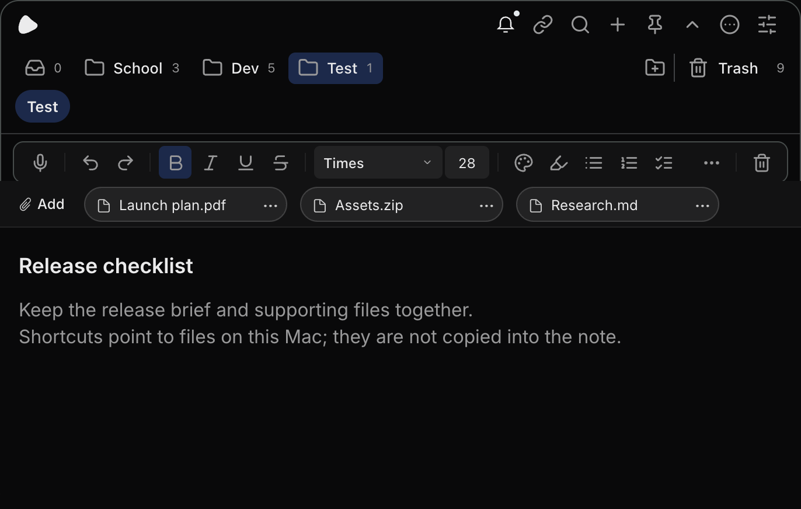
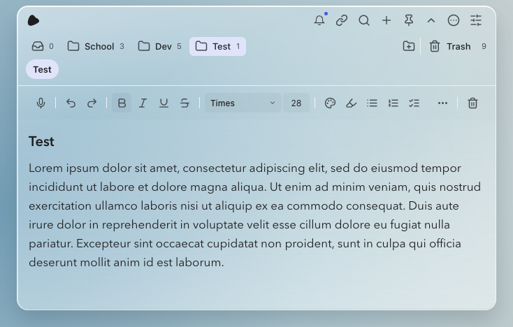
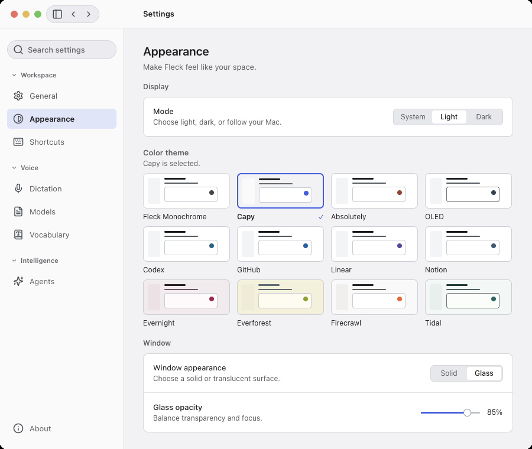
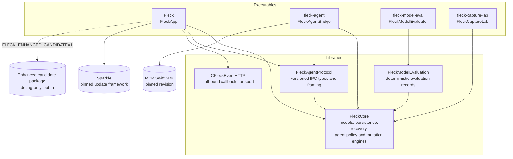
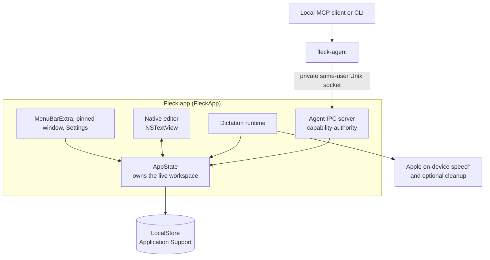
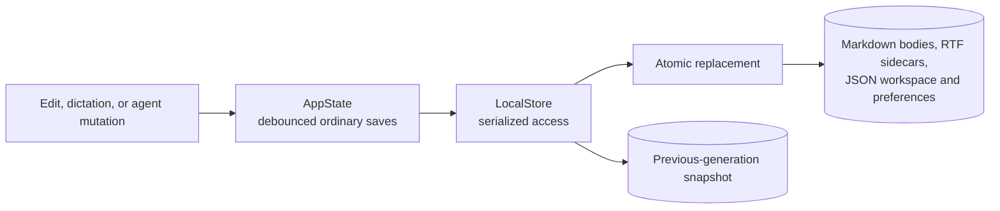
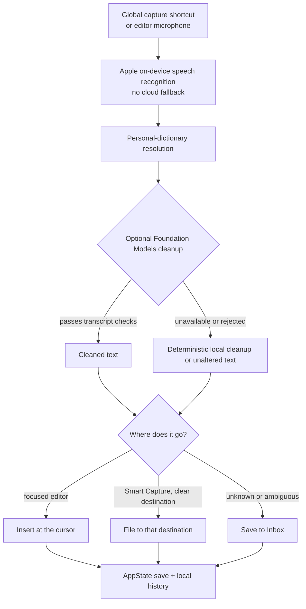
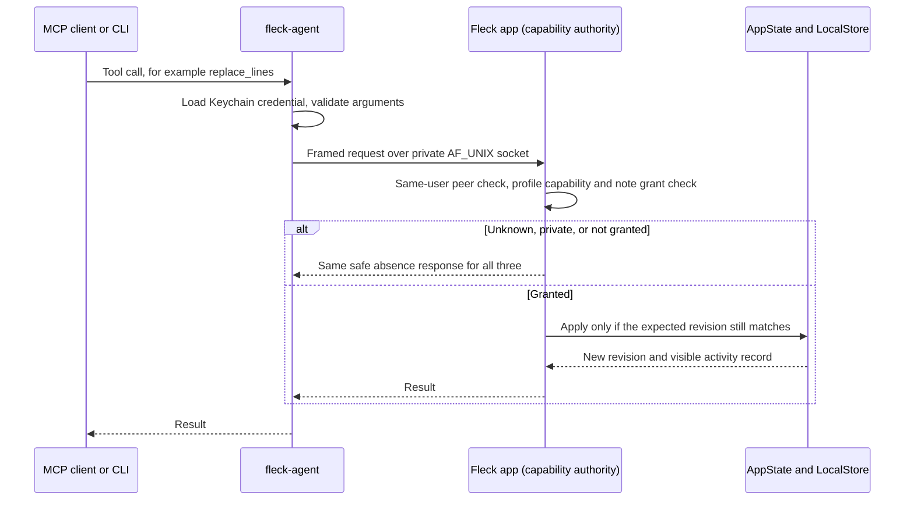

<h1 align="center">
  <picture>
    <source media="(prefers-color-scheme: dark)" srcset="Assets/Brand/fleck-lockup-white.png">
    
  </picture>
</h1>

<p align="center">A native, local-first macOS notes workspace for quick capture, focused editing, on-device dictation, and explicitly granted local agent access.</p>

<p align="center">
  <a href="#requirements"></a>
  <a href="Package.swift"></a>
  <a href="https://github.com/elevatesoft/Fleck/actions/workflows/ci.yml?query=branch%3Amain"></a>
  <a href="LICENSE"></a>
</p>

<p align="center">
  <a href="#download-and-launch-fleck">Download &amp; launch</a> ·
  <a href="https://github.com/elevatesoft/Fleck/releases">Release notes</a> ·
  <a href="#first-launch">First launch</a> ·
  <a href="#what-is-here">Features</a> ·
  <a href="#how-it-works">How it works</a> ·
  <a href="#architecture">Architecture</a> ·
  <a href="#build-and-test">Build &amp; test</a> ·
  <a href="TESTING.md">Testing</a> ·
  <a href="#contributing">Contributing</a> ·
  <a href="SECURITY.md">Security</a>
</p>

---

Fleck lives in your menu bar. Click it to jot a note, hold a shortcut to dictate, or let a local AI tool you have explicitly authorized read and edit the specific notes you chose. Notes are readable Markdown files on your Mac. Speech recognition runs on-device; optional text cleanup uses Apple's on-device language model when it is available. The ordinary app needs no Fleck account, cloud sync, separate Fleck model download, or browser runtime.

| | |
| --- | --- |
| **Platform** | macOS 14 declared deployment target; see the release notes for the app's compatibility |
| **Stack** | Swift 6, SwiftUI shell, AppKit `NSTextView` editor, Apple on-device speech, [MCP Swift SDK](https://github.com/modelcontextprotocol/swift-sdk) for the agent bridge |
| **Storage** | Readable Markdown notes, optional RTF sidecars, and JSON settings in Application Support; atomic writes plus a recovery snapshot |
| **Network** | No account or cloud sync for ordinary note-taking. Agent note requests use a private same-user Unix socket, not an inbound HTTP listener. Outbound event callbacks are separately opt-in |
| **License** | [MPL-2.0](LICENSE), with the boundaries in [NOTICE](NOTICE) and [Branding](BRANDING.md) |

## Download and launch Fleck

Open [GitHub Releases](https://github.com/elevatesoft/Fleck/releases) and choose
a release with a prebuilt app for your Mac. Its release notes list what's
included, system requirements, signing information, and the checksum.

### Installing the app release

**These steps use the published app ZIP on GitHub Releases — not the source code.**

1. Under the release's **Assets**, download the **Fleck app ZIP** for your Mac.
   Do **not** choose **Source code (zip)** or **Source code (tar.gz)**; neither
   contains a ready-to-run app. Verify the ZIP against the SHA-256 checksum in
   the release notes before opening it.
2. Double-click the ZIP in Finder to extract it, then drag the app into
   **Applications**, keeping its name.
3. Open **Applications** and double-click Fleck. If macOS blocks it, check the
   release's signing notes and [Apple's guidance](https://support.apple.com/en-us/102445)
   rather than disabling Gatekeeper or removing quarantine protection.

### First launch

1. Look for Fleck's four-tile icon in the **macOS menu bar** and click it to
   open the workspace. Fleck is a menu-bar app, so don't look for it in the Dock.
2. Create a note, give it a title, and start typing. Fleck saves it
   automatically on your Mac; you don't need dictation or agent access to write.
3. To try dictation, click the microphone in the formatting toolbar. If macOS
   prompts you for **Microphone** or **Speech Recognition** permission, allow
   those only if you want to dictate. Standard dictation uses Apple's
   on-device speech recognition.
4. To connect an AI tool, set up the optional [Agent Connector](#agent-connector)
   in Settings. It gets no note access until you grant capabilities and choose
   which notes or folders to share.

A prebuilt app doesn't require Xcode, Swift, or Terminal build commands.
Developers can instead [get the source](#get-the-source) and
[build and test](#build-and-test). Packaged development apps require the
maintainer's accepted-build registry; those commands aren't an end-user installer.

The sections below describe **current public source**, which can be ahead of
the downloadable app. [`VERSION`](VERSION) is the source-version authority;
see the [changelog](CHANGELOG.md) for source changes and the [release
notes](https://github.com/elevatesoft/Fleck/releases) for what ships in each
download. Local development builds and CI artifacts aren't public releases.
See the [release policy and binary-distribution checklist](docs/RELEASES.md)
for the current release gates.

## What is here



Illustration from a development build with synthetic notes and a sample file
shortcut. The Project notes tab shows where you write, format, and dictate;
the file shortcut opens a local reference without importing it.

The ordinary build from public `main` contains:

| Area | Current implementation |
| --- | --- |
| Native workspace | Menu-bar workspace and an independently sized pinned window. |
| Notes and organization | Local notes, tabs, folders, search, backlinks, 30-day Trash, recovery, text/Markdown import, and plain-text/Markdown/RTF export. |
| File shortcuts | A native single-file chooser adds local file references; compact rows can open, reveal, relink, or remove them. Shortcuts stay on this Mac and are not included in note exports. |
| Native editor | An AppKit `NSTextView` editor with native undo, formatting, lists, checklists, and inline display of image files pasted or dropped from Finder. |
| On-device dictation | Apple on-device speech recognition, optional faithful local cleanup, and Inbox-safe Smart Capture routing. |
| Agent Connector | A separately packaged local helper with profile-scoped capabilities, explicit note or folder grants, visible activity, revision checks, and Undo. |
| Local persistence | Readable local storage with atomic replacement and a previous-generation recovery snapshot. |

Inline image import accepts image **file URLs**, such as files copied or dragged
from Finder; it does not import raw PNG or TIFF bitmap clipboard payloads.
Fleck copies valid images of up to 100 MiB and 100 million pixels into its local
image library, keeps the imported original bytes across editor undo and redo,
and initially fits the displayed image proportionally to the available
editor width with a 320-point height cap. The editor also supports resizing
and rotating inline images. Notes, RTF state, exports, and agent
text retain absolute local-file Markdown references, so image content is not a
portable or self-contained export.

Copying a selection that mixes text and images puts real image data on the
clipboard: rich HTML with embedded PNG images, an RTFD flavor with in-memory
attachments, and sanitized plain and RTF fallbacks that describe images instead
of exposing local file paths. Pasting that content back into Fleck restores the
managed images and formatting through a private pasteboard payload, while raw
PNG or TIFF bitmap payloads from other apps are still not imported.

Selected-text drags retain AppKit formatting. The editor has optional scroll-edge
blur, and Agent Activity shows line diffs for eligible edits.

See [Implementation status](IMPLEMENTATION_STATUS.md) for the short current
roadmap and [Architecture](ARCHITECTURE.md) for the system boundaries.

### Capy-theme design preview

The light Capy theme in the Notes workspace and Appearance settings. These
are design mockups, not screenshots of the downloadable app. Open either
image for a closer look.

<p>
  <a href="docs/images/fleck-capy-notes.webp"></a>
  <a href="docs/images/fleck-capy-appearance.webp"></a>
</p>

## How it works

Fleck has three everyday flows. Each one ends in the same place: a single state owner (`AppState`) that applies the change and saves it.

1. **Write.** Click the menu-bar icon (or open the pinned window) and type. The editor is a real macOS text view with native selection, input methods, spelling, undo, and VoiceOver support. Edits go to `AppState`, which hands them to `LocalStore` to save.
2. **Dictate.** Hold the global shortcut and speak. Apple's on-device recognizer transcribes, your personal dictionary corrects known terms, and optional cleanup is checked against the transcript. The result is inserted where you are, or filed by Smart Capture. If Fleck is unsure where it belongs, it goes to your Inbox.
3. **Connect an agent (optional, off by default).** Create a profile, grant it capabilities, and share specific notes or an explicitly confirmed folder. A local MCP client talks to the `fleck-agent` helper, which talks to the app over a private socket. Every write names the revision it expects, so it cannot silently overwrite newer work, and applied changes show up in Activity, with Undo for eligible edits.

## Architecture

Fleck is one Swift package with a deliberate dependency direction: portable note state at the bottom, macOS presentation on top, and every optional integration behind an explicit boundary. See [Architecture](ARCHITECTURE.md) for the full system boundaries.

### Package structure



`FleckCore` has no UI dependency, and `FleckAgentProtocol` depends only on core value types. The app and the bridge never import each other: they meet across the protocol. See [the package manifest](Package.swift) for the full graph and [the lockfile](Package.resolved) for exact dependency pins.

| Target | Responsibility |
| --- | --- |
| `FleckCore` | Note and workspace models, mutations, Markdown operations, search and backlinks, preferences, persistence and recovery, import/export, personal dictionary, dictation history, and agent policy, mutation, undo, and activity engines. |
| `FleckAgentProtocol` | Versioned request and response types, endpoint conventions, and framed local IPC. |
| `FleckApp` | macOS lifecycle, menu-bar and pinned-window scenes, AppKit editor, onboarding, settings, dictation, and the in-app agent service. |
| `FleckAgentBridge` | The separately packaged `fleck-agent` MCP/CLI process: Keychain credential lookup, argument validation, and the Unix-socket client. |
| `CFleckEventHTTP` | Outbound transport for approved agent event callbacks. |
| `FleckModelEvaluation` / `FleckModelEvaluator` | Deterministic evaluation records and a command-line evaluator (`fleck-model-eval`) for local-model candidates. |
| `FleckCaptureLab` | Developer tooling (`fleck-capture-lab`) for controlled visual capture. Not part of the core note path. |

### Runtime composition



`AppState` is the single owner of the live workspace. It coordinates saves, recovery, Trash, import/export, search, file references, and agent mutations, so every change, whether it came from you, from dictation, or from an agent, follows the same path and is visible the same way. SwiftUI presents the shell; the editor wraps a real `NSTextView` so the macOS text system keeps doing the hard parts.

### Storage and recovery



Fleck stores readable Markdown note bodies, optional RTF sidecars, and JSON workspace and preference data under your Application Support directory. `AppState` debounces ordinary saves. `LocalStore` serializes access, writes with atomic replacement, and keeps a previous-generation snapshot for recovery. This makes the data inspectable and crash-tolerant. **It is not encryption**: software already running as your macOS user can operate within your user's authority. Agent Connector secrets belong in Keychain, never in note files or preferences.

See the [storage boundary](ARCHITECTURE.md#storage-boundary) for more detail.

### Dictation pipeline

Standard dictation uses **Apple Speech** for transcription and keeps audio
on-device. On macOS 26 or later it uses `SpeechAnalyzer` with
`DictationTranscriber` and requires ready system speech assets for the locale.
Earlier supported macOS versions use `SFSpeechRecognizer` in on-device mode.
Neither path sends audio to a cloud recognizer when local speech is unavailable.

After personal-dictionary resolution, Fleck can use **Apple Intelligence's
on-device language model** through Foundation Models for cleanup and Smart
Capture routing. This is a separate text step, not speech recognition. It
requires macOS 26 or later, an eligible Mac with Apple Intelligence enabled,
and a ready system model.



- Model output is checked against the transcript. If cleanup is unavailable or
  rejected, Fleck can apply limited non-model cleanup where safe, or keep the
  dictionary-resolved text. If Smart Capture can't resolve a destination, it
  saves to the Inbox.
- Audio buffers are transient. Dictation history stores text and outcome metadata, **not recorded audio**.
- The [dictation boundary](ARCHITECTURE.md#dictation-boundary) describes the capture modes and fallbacks. Use synthetic content and sanitize evidence for [native dictation testing](TESTING.md#dictation).

### Agent Connector

The connector is **off until you create a profile and grant capabilities**. A profile can receive four capabilities, plus explicit note grants or an explicitly confirmed folder grant that may include future notes in that folder. See the [agent workspace boundary](ARCHITECTURE.md#agent-workspace-boundary) for the local authorization rules.



The bridge exposes a static registry of **13 MCP note and activity tools**. The list is filtered by the profile's current capabilities. The app also checks the target's note or folder grant on each call.

| Capability | Tools |
| --- | --- |
| `notes.list` | `list_shared_notes` |
| `notes.read` | `read_note`, `list_tasks`, `list_agent_activity` |
| `notes.write` | `append_text`, `insert_text`, `replace_lines`, `delete_lines`, `add_task`, `rename_task`, `set_task_state`, `remove_task` |
| `changes.undo` | `undo_agent_change` |

Safety properties built into the protocol:

- **No blind overwrites.** Every write carries the revision it expects and a caller-owned operation ID, so stale writes do not clobber newer work and a retried write does not duplicate. Line replacement and deletion also carry a SHA-256 of the lines the caller observed.
- **Bounded input.** Text arguments are capped at 65,536 UTF-8 bytes, and tool schemas reject unknown properties.
- **No enumeration.** Unknown, private, and unauthorized targets return the same safe absence response, so error messages cannot be used to discover which notes exist.
- **Visible and reversible.** Activity returns through the same state owner as every other change, and eligible changes can be undone.
- **Local request path.** A private `AF_UNIX` socket with same-user peer checks; credentials live in Keychain. The note request path has no inbound HTTP listener.

> **Trust boundary.** This is a cooperative local-client boundary. It limits accidental or over-broad access by clients you configured; it cannot defend against malicious software already running as your macOS user or control a connected client's use of an online service.

Public `main` also contains opt-in note and task event subscriptions. Observation is off by default. Outbound, signed callbacks require scoped owner consent and a verified HTTPS endpoint. See the [changelog](CHANGELOG.md).

### Optional Enhanced Local graph

The experimental Enhanced Local graph includes **NVIDIA Parakeet TDT 0.6B v2**
(Core ML) for local transcription and **Google Gemma 3 1B IT** (MLX, 4-bit QAT)
for local transcript cleanup and Smart Capture routing. This is an opt-in
debug path, not the ordinary app. Ordinary packages don't bundle either
model's weights. The source manifests identify the weights; they don't install
or activate them. Parakeet requires verified local assets and runtime readiness.
For cleanup and model-assisted routing, an available Apple system model takes
precedence; Gemma is an option only when the system model is unavailable and
the local Gemma runtime is ready.

| | Ordinary build | With `FLECK_ENHANCED_CANDIDATE=1` |
| --- | --- | --- |
| Dependencies | The pinned [MCP Swift SDK](https://github.com/modelcontextprotocol/swift-sdk) and Sparkle, with resolutions in [`Package.resolved`](Package.resolved) | Adds the candidate dependency package and its reviewed pins |
| Enhanced source files | `EnhancedModelManager.swift` and `EnhancedSpeechCapture.swift` are excluded from the app target | Included, and app resources are processed |
| Compile flags | None | `CLEAN_DICTATION_ENHANCED_CANDIDATE_REQUESTED` always; `CLEAN_DICTATION_ENHANCED_CANDIDATE` in **debug configurations only** |
| Distribution | Default source graph; a build from it isn't necessarily a release | Not approved for distribution; has separate legal, model-integrity, performance, and distribution gates |

See the [Enhanced Local test guidance](TESTING.md#enhanced-local-candidate)
before selecting this graph. An ordinary contribution does not need a model
download.

### Design principles

- **Native and simple.** AppKit, SwiftUI, Foundation, and the macOS text system before any dependency or replacement control.
- **Local-first.** Ordinary notes and settings live in your Application Support directory; core note use has no server dependency.
- **Truthful persistence.** Mutations become visible through one state owner and are saved with atomic replacement and recovery data.
- **Bounded integration.** Dictation and agent access fail closed or fall back to a safe local result rather than broadening access.
- **Accessible and efficient.** Keyboard use, VoiceOver, Reduce Motion, contrast, idle CPU, memory pressure, and thermal state are architectural inputs, not afterthoughts.

Dependencies stay rare: a new one needs a concrete runtime or maintenance benefit, compatible licensing, a reviewed immutable resolution, and no unnecessary effect on the ordinary app's size, network behavior, or idle resources. The ordinary package pins the Model Context Protocol Swift SDK and Sparkle; their resolutions are recorded in [`Package.resolved`](Package.resolved).

## Requirements

These are **source-development requirements**. For a published prebuilt app, use the macOS and architecture requirements listed in its release notes instead.

| Requirement | Version or scope |
| --- | --- |
| macOS | 14 as the declared minimum deployment target. |
| Xcode | 26 or later, with the full macOS 26 SDK selected. |
| Swift | 6. |

The deployment target is not a completed compatibility matrix. Current local
validation is on Apple silicon; native Intel compatibility and a full macOS 14
native pass have not been verified. Source tests and offscreen component
captures do not establish live-app or VoiceOver behavior.

The standalone Command Line Tools are not enough for this source tree. Check the
active toolchain without building. See [Testing requirements](TESTING.md#requirements) for setup:

```sh
xcodebuild -version
xcrun --sdk macosx --show-sdk-version
swift --version
```

## Get the source

[Fork the repository](CONTRIBUTING.md#set-up-a-fork) on GitHub, then clone your fork:

```sh
git clone https://github.com/YOUR-USER/fleck.git
cd fleck
git remote add upstream https://github.com/elevatesoft/Fleck.git
```

If you only want to inspect or test the canonical source, clone the upstream URL
directly instead.

## Build and test

Run the ordinary Swift package tests from the repository root:

```sh
unset FLECK_ENHANCED_CANDIDATE
Scripts/run-nonempty-swift-tests.sh '^.+$'
```

The test runner does not launch the product `Fleck.app`, but its synthetic
AppKit host may create fixture windows and change focus. Run native fixtures in
a disposable macOS test account or session with synthetic content.

Pull requests that only add or modify the root `README.md` use lightweight
documentation validation. The required `macOS build and tests` check runs on
both routes; a docs-only pass does not claim that Swift tests or packaging ran.
See [Testing](TESTING.md#ordinary-automated-checks) for focused tests and the
full ordinary macOS gate.

Maintainer handoff packaging requires a clean committed source tree and the
project's private accepted-build registry. It builds the development-signed app
bundle without launching it. See the [packaging guide](TESTING.md#packaged-native-app) and [build identity](docs/build-identity.md#packaging-identity) for the receipt contract:

```sh
unset FLECK_ENHANCED_CANDIDATE
mkdir -p .build
RESULT_DIR="$(mktemp -d "$PWD/.build/development-result.XXXXXX")"
RESULT_FILE="$RESULT_DIR/build-result.json"
Scripts/build-fleck-app.sh --result-file "$RESULT_FILE"
FLECK_APP="$(Scripts/fleck-build-identity.py read-result \
  --repo "$PWD" \
  --result-file "$RESULT_FILE" \
  --flavor development)"
printf 'Built %s\n' "$FLECK_APP"
```

Interactive native testing is a separate, explicit step:

```sh
/usr/bin/open -n "$FLECK_APP"
```

Every packaging invocation allocates an immutable
`Fleck <version> Build <number>` app name. A requested result file appears only
after the local bundle is verified, so consumers use that exact path
instead of guessing a newest artifact or replacing an earlier build.
Hosted CI uses the explicit `ci-unverified` mode for non-handoff packaging;
contributors without the private registry must not bypass the local checks or
describe a CI artifact as accepted.

Opening Fleck creates local Application Support data and may request macOS
permissions. Use a disposable macOS test account and synthetic fixtures, never
personal notes or recordings. The full commands and manual checks are in
[Testing](TESTING.md).

## Repository map

| Path | Responsibility |
| --- | --- |
| `Sources/FleckCore/` | Local models, mutations, persistence, recovery, search, backlinks, personal dictionary, and agent policy and mutation engines. |
| `Sources/FleckAgentProtocol/` | Typed local IPC protocol and framing. |
| `Sources/FleckApp/` | Native macOS UI, editor, dictation, onboarding, settings, and the in-app IPC service. |
| `Sources/FleckAgentBridge/` | MCP/CLI helper (`fleck-agent`), tool registry, and Unix-socket client. |
| `Sources/CFleckEventHTTP/` | Outbound transport for approved event callbacks. |
| `Sources/FleckModelEvaluation/` | Deterministic local-model evaluation support. |
| `Sources/FleckCaptureLab/` | Developer capture tooling. |
| `Tests/` | Swift tests and privacy-safe fixtures. |
| `Scripts/` | Build, validation, audit, and profiling entry points. |
| `Packages/` | Enhanced candidate dependency package. |
| `docs/` | Release policy and notes, build identity, design, evaluation, performance, testing, and theme documents. |

## Documentation

| Topic | Reference |
| --- | --- |
| What Fleck is for | [Product](PRODUCT.md) · [Product plan](PRODUCT_PLAN.md) |
| System boundaries | [Architecture](ARCHITECTURE.md) |
| Current roadmap | [Implementation status](IMPLEMENTATION_STATUS.md) |
| Tests and evidence | [Testing](TESTING.md) |
| Releases and distribution | [Release policy](docs/RELEASES.md) · [Build identity](docs/build-identity.md) · [Changelog](CHANGELOG.md) |
| Security reporting | [Security](SECURITY.md) |
| Contributing | [Contributing](CONTRIBUTING.md) · [Code of Conduct](CODE_OF_CONDUCT.md) |
| Name, brand, and licenses | [Branding](BRANDING.md) · [Notice](NOTICE) · [Third-party notices](THIRD_PARTY_NOTICES.md) |

## Project principles

Fleck keeps the frequent path small and native. Prefer Apple frameworks and the
standard text system over embedded web views or replacement controls; avoid
background services and dependencies without a demonstrated need; keep notes
local by default; and preserve keyboard access, VoiceOver semantics, Reduce
Motion, contrast, and resource efficiency as features evolve.

## Contributing

Public [issues](https://github.com/elevatesoft/Fleck/issues) and pull requests are open for ordinary bugs, feature proposals,
and focused contributions. Start with [Contributing](CONTRIBUTING.md),
[Testing](TESTING.md), and the [Code of Conduct](CODE_OF_CONDUCT.md).

Keep sensitive reports out of public issues and pull requests. Security
vulnerabilities use the private route in [Security](SECURITY.md); conduct
reports use the private route in the [Code of Conduct](CODE_OF_CONDUCT.md).

## License and name

Fleck-owned source and documentation in the current tree are licensed under the
[Mozilla Public License 2.0](LICENSE), subject to the boundaries in
[NOTICE](NOTICE), [Branding](BRANDING.md), and
[Third-party notices](THIRD_PARTY_NOTICES.md). Earlier revisions remain subject
to the license notices and terms accompanying those revisions. No contributor
license agreement is required. The Fleck name, logo, and other brand assets are
reserved separately; the source license does not grant trademark rights.

Ordinary Swift dependencies include MIT- and Apache-2.0-licensed code;
documentation, data, and models can carry other terms. Exact pins and
attributions are recorded in the package lockfiles and
[`ThirdPartyNotices.md`](Sources/FleckApp/Resources/ThirdPartyNotices.md).
